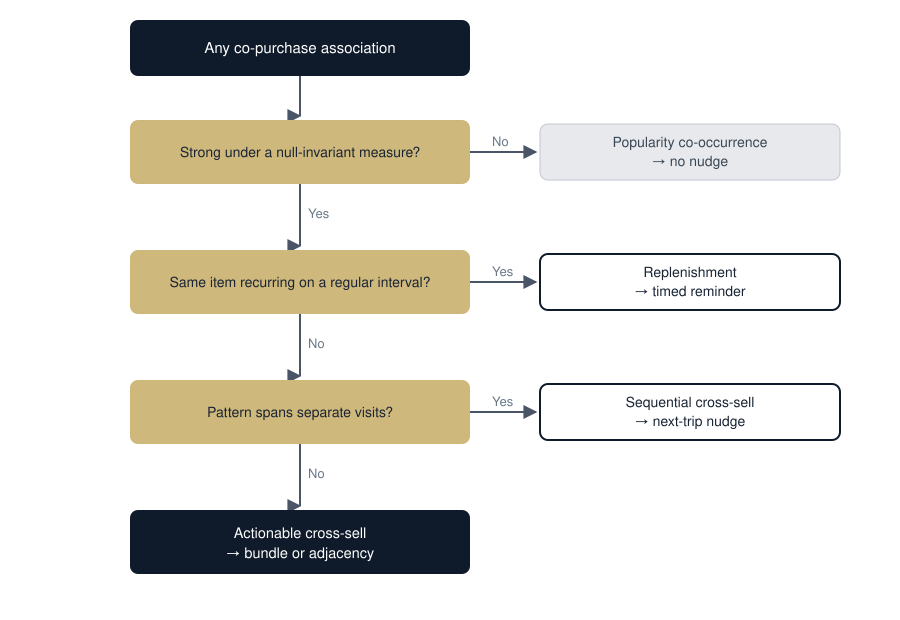
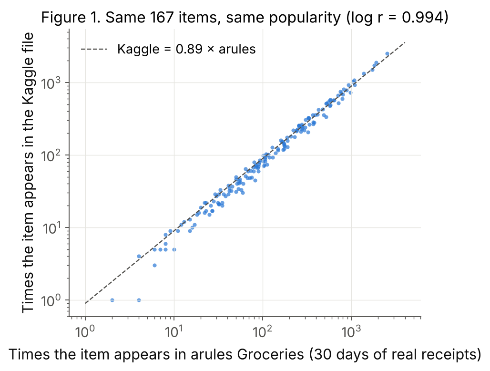
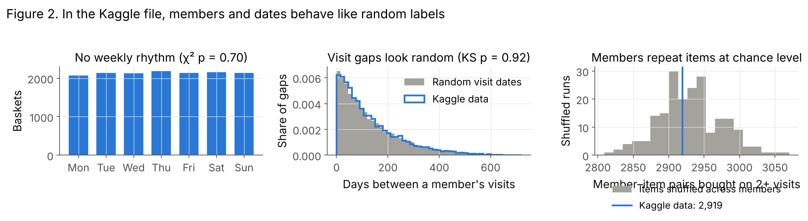
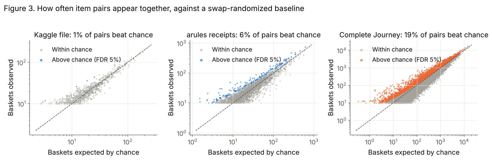
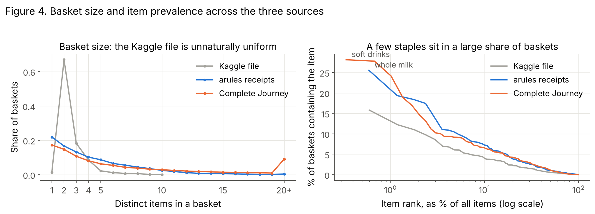
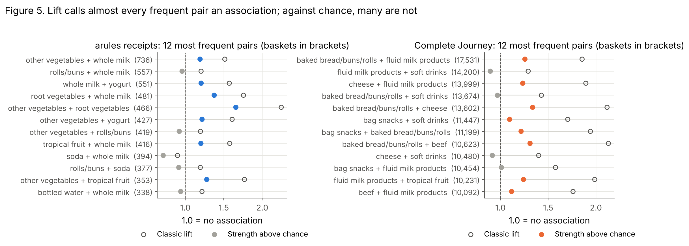
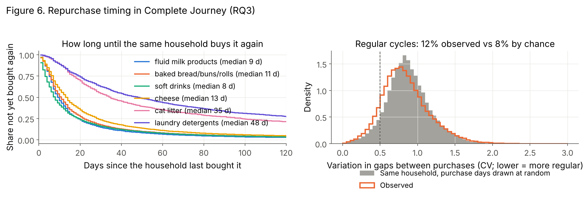
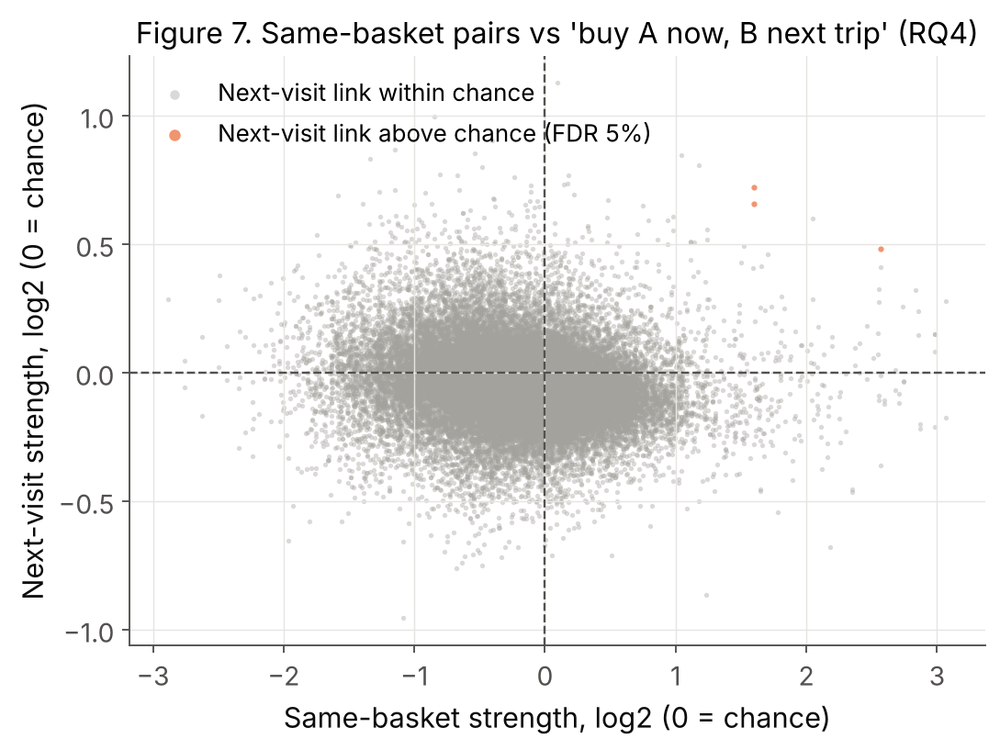
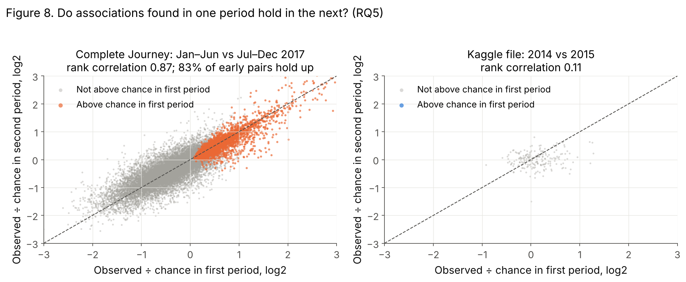

---
---

# Beyond Bought-Together
#### Actionable cross-sell versus popularity in grocery baskets

CSCI 5502 Data Mining, University of Colorado Boulder. By Bhaveeasheshwar Eswaran and Raghavendra Kumaran.

## Introduction

A grocery retailer gets only a few moments to influence a shopper. An endcap, a "frequently bought together" slot, one CRM email before the customer stops paying attention. This project asks how to spend those moments on associations that actually change a basket, instead of ones that just describe what everyone already buys.

### The problem and the decision

Retailers usually rank recommendations by how often two items show up together. The problem is that raw co-occurrence is driven by staples. Bread and milk land in thousands of baskets because both are close to universal, not because one pulls in the other. Suggesting milk to someone already buying bread changes nothing.

Frequency also mixes up two behaviors that need opposite responses. Some items get bought on a schedule, which is replenishment. Others genuinely go with a different item, which is complementary cross-sell. A system that cannot tell them apart bundles what it should be reminding about and reminds about what it should be bundling.

So the decision this project serves is a practical one. Given a fixed budget of recommendation slots and nudges, which product associations deserve one, and which kind of nudge should each one get?

### Why it matters

Recommendation space is limited and every nudge has a fatigue cost. A slot filled with an obvious staple is a slot not spent changing behavior, and an unnecessary email chips away at the attention the retailer can draw on later. Telling actionable associations apart from popularity is really a question about the return on limited attention, about spending it on changing baskets rather than narrating habits.

### Stakeholders

- **Category managers** decide shelf adjacency, endcaps, and promotional bundles. They need to know which pairs are worth physically placing together.
- **CRM and lifecycle marketing teams** send app and email nudges. They need replenishment items routed to timed reminders and cross-sell pairs routed to bundle offers, which are two different campaigns.
- **Shoppers** benefit from relevant, well-timed suggestions. They are hurt by spammy, obvious ones that train them to ignore recommendations altogether.
- **Inventory and store operations** feel the downstream effect. Bundling changes how demand correlates and how shelves are laid out, so a wrong call carries a physical cost.

### What is already known, and the gap

Market-basket analysis is well established. Apriori and FP-Growth find frequent itemsets efficiently, and the field has long known that support and confidence over-reward popular items, which is why lift and other interestingness measures exist. Retailers ship "frequently bought together" features built on exactly this machinery.

The gap is operational rather than algorithmic. Standard practice still ranks by frequency-driven measures and treats every co-occurrence as the same kind of thing. What tends to be missing, and what this project builds, is a principled split of popularity, replenishment, and genuine cross-sell, with each one mapped to the intervention it deserves and each tested for whether the pattern is real or just an artifact of a common measure.

### Routing every association to its intervention

The organizing idea is to stop producing one ranked rule list and instead sort each association by two things. First, how much stronger the pairing is than chance under a measure that popularity cannot fool. Second, what temporal shape the behavior has, whether it happens in one basket, repeats on a schedule, or plays out across separate visits. Those two axes place every association into one of four groups, and each group gets its own action.



*An association earns a nudge only if it survives the popularity test, and the kind of nudge depends on the timing of the behavior. Leaving popularity co-occurrences alone is an explicit output, not a gap.*

### Project blueprint

1. **Baseline.** Build baskets from same member and same date, then produce a plain frequency ranking as the naive benchmark the project will argue against.
2. **Strength, done properly.** Re-score pairs with a null-invariant measure and measure how much of the frequency top list is really popularity.
3. **Behavior split.** Use each member's purchase intervals to separate scheduled replenishment from complementary co-purchase.
4. **Across visits.** Mine cross-visit sequential patterns and compare them to same-basket associations.
5. **Credibility.** Check which flagged associations hold up across time, and present the routed rule set as the final evidence.

## Research Questions

Five questions, ordered so each one builds on the last. RQ2 is the primary question. After the Milestone 2 data audit, RQ1 and RQ2 are answered on real till receipts and household data, and RQ3 to RQ5 on The Complete Journey, which follows the same households through 2017.

**RQ1. How much of the standard "frequently bought together" ranking survives a chance baseline that holds basket size and item popularity fixed, and how badly does lift mislead?** *(Descriptive and diagnostic.)* We can answer this by ranking pairs two ways, once by raw co-occurrence and once by strength above a swap-randomized chance baseline, then looking at how much the two lists overlap and how often lift calls a pair positive when chance says it is not. A small overlap puts a number on the problem the whole project rests on.

**RQ2. Which associations are actionable cross-sell, meaning they beat chance, the paired item is not a near-universal staple, and they ideally cross departments, as opposed to popularity-driven co-occurrence?** *(Relationship and pattern. Primary.)* This is the core deliverable. We can answer it by scoring candidate pairs on strength above chance, adjusted for thin evidence, along with directional asymmetry, then filtering out the ones whose second item almost everyone buys anyway.

**RQ3. How many household and category purchase histories follow a regular cycle beyond the household's own shopping rhythm, and what share of purchase volume do they cover?** *(Explanatory and behavioral.)* We can answer this per household in The Complete Journey by sorting each category's purchase dates, measuring how predictable the gaps are, and comparing that with the same purchases placed on random trips of the same household. Very regular cadences count as replenishment. This is what sends an association to a timed reminder instead of a bundle.

**RQ4. Is cross-visit co-purchase driven by sequence, meaning A now and B on the next trip, or by household taste, meaning the same households buy both at any time?** *(Sequential and temporal.)* Milestone 2 found that next-visit links almost never beat a shuffle of each household's own trips, so the original premise is replaced. We can answer this by ordering each household's trips by date, measuring next-visit pairs against that within-household shuffle, and comparing their strength to the same pairs measured inside a single basket.

**RQ5. Which associations flagged as actionable in January to June 2017 still hold in July to December, so we can separate durable signal from sampling noise?** *(Stability and validation.)* We can answer this by finding candidates in the first half of the year in The Complete Journey and testing whether they still beat chance in the second half. The survivors form the credible set the project stands behind.

## Data and Exploration

Milestone 2 builds the data the rest of the project stands on and checks what that data can and cannot support. The full write-up, with the cleaning log and every table, is the [Milestone 2 report (PDF)](https://github.com/bhav06-10/Beyond-Bought-Together-Actionable-Cross-sell-vs.-Popularity-in-Grocery-Baskets/blob/main/reports/milestone2_report.pdf), also available as a [Word file](https://github.com/bhav06-10/Beyond-Bought-Together-Actionable-Cross-sell-vs.-Popularity-in-Grocery-Baskets/blob/main/reports/milestone2_report.docx). Every number below can be rebuilt from the repository with `make all`.

### Data at a glance

| Source | What one row is | Size | Coverage | Used for |
| --- | --- | --- | --- | --- |
| [Kaggle Groceries](https://www.kaggle.com/datasets/heeraldedhia/groceries-dataset) (Heeral Dedhia) | One item on a member's shopping day | 38,765 rows, 3,898 members, 167 items | Labelled 2014 to 2015 | Provenance audit, and a control with no real customer or time signal |
| [arules Groceries](https://search.r-project.org/CRAN/refmans/arules/html/Groceries.html) (Hahsler, Hornik, and Reutterer, 2006) | One till receipt | 9,835 receipts, 169 categories | 30 days, one store | RQ1 and RQ2 |
| [The Complete Journey](https://cran.r-project.org/web/packages/completejourney/vignettes/completejourney.html) (84.51°) | One product line in a household's shopping trip | 1.47 million lines, 2,469 households | All of 2017, US | RQ1 to RQ5 |

All three were downloaded directly on 17 October 2026. Raw data is not stored in the repository. `data/README.md` explains how to get each file, and a hash check makes sure everyone analyses exactly the same bytes.

### Where the Kaggle data really comes from



*Every one of the Kaggle file's 167 items appears in the arules receipts with almost identical popularity, and the two labels that carry a stray trailing space in arules (`cream cheese `, `roll products `) carry the same space in Kaggle. arules documents 30 days of receipts, while the Kaggle file claims two years. We read this as strong evidence that the Kaggle file is the arules receipts with member numbers and dates added later.*

### What the data can and cannot support



*In the Kaggle file there is no weekly rhythm, visit gaps look like random dates, and members re-buy items exactly as often as chance predicts (2,919 times against 2,930). The member and date fields carry no real signal, so the customer and time questions move to The Complete Journey.*



*Against a baseline that keeps every basket's size and every item's popularity fixed, 0.7% of pairs beat chance in the Kaggle file, 6% in the real receipts, and 19% in the household data.*

### Data dictionary

| Variable | Source | Meaning | Type |
| --- | --- | --- | --- |
| Member_number / household_id | Kaggle / Complete Journey | Customer identifier | Text ID |
| Date / transaction_timestamp | Kaggle / Complete Journey | When the purchase happened | Date / datetime |
| itemDescription / product_category | Kaggle and arules / Complete Journey | Item category | Categorical (167 / 169 / 295 values) |
| quantity, sales_value | Complete Journey | Units and dollars on the line | Number |
| basket | All | Unit of analysis: member and date, receipt, or trip | Text ID |
| expected, ratio, strength | Derived | Chance count for a pair, observed divided by chance, and the same ratio pulled toward 1 when evidence is thin | Number |
| gap, cv | Derived | Days between a household's purchases of a category, and how regular those gaps are | Number |

### How we prepared the data

| Decision | Before | After |
| --- | --- | --- |
| Date parsing | `05-01-2015` read as 1 May by a default parser | Explicit day-first format gives 5 January (39% of rows were at risk) |
| Label cleaning | `cream cheese ` and `cream cheese` counted as two items | One item, in the dairy department |
| Duplicates | Two identical `rolls/buns` rows in one member's day | One basket entry with a count of 2. Random assembly would create about 806 such repeats, and we see 759 |
| Service lines | Fuel lines with quantities up to 89,638 | Fuel, coupons and postal lines removed (1.3% of lines) |
| Chance baseline | Lift of 0.77 makes other vegetables with whole milk look negative | Chance expects 227 baskets and we see 222, so there is no association either way |

We never scale, normalise or impute. The only hand-made input is a reviewed label-to-department map.

### Quality, bias, and ethics

- **Confirmed from Milestone 0.** One retailer per source, so results may not transfer between chains.
- **Reduced.** Missing price and quantity, since The Complete Journey has both. Re-identification, since we publish aggregates only.
- **New.** The Kaggle member and date fields behave like random labels. Lift is biased by basket size. Complete Journey households are frequent shoppers, not a random sample.
- **The limitation we cannot fix.** No dataset records what happens after a recommendation, so our results are candidate cross-sells to test, never proven sales lift.

### Exploration



*Real baskets range from a single item to stock-up trips of 80 or more, while the Kaggle file is two items two-thirds of the time. A handful of staples, such as whole milk and soft drinks, sit in over a quarter of baskets.*



*Lift calls almost every frequent pair a positive association. Against chance, many are not. Milk with soft drinks has a lift of 1.29 but appears 11% less often than chance, and none of the 20 most frequent pairs is among the 20 strongest.*



*Milk and bread come back within about 10 days, laundry detergent in about 48. Only 12% of purchase histories follow a regular cycle, against 8% by chance, and most of those are household consumables.*



*"Buy A now, B on the next trip" almost never beats a shuffle of the same household's trips (3 of 33,948 pairs). Cross-visit patterns reflect household taste, not sequence.*



*Associations found in January to June 2017 hold in July to December, where 83% still beat chance. In the Kaggle file, nothing carries over.*

### How the research questions changed

| | Change | Why |
| --- | --- | --- |
| RQ1 | Sharpened | Lift itself misleads, so the comparison is now against a chance baseline that holds basket size and popularity fixed |
| RQ2 | Kept, still primary | The chance baseline makes "not a staple" and "across departments" measurable |
| RQ3 | Revised, new data | Kaggle dates carry no signal, so regularity is measured in The Complete Journey against each household's own shopping rhythm |
| RQ4 | Premise replaced | Next-visit links almost never beat a within-household shuffle |
| RQ5 | Kept, new data | Holdout is now January to June against July to December 2017 |

### Reproduce our work

```bash
pip install -r requirements.txt
# put Groceries_dataset.csv in data/raw/ (see data/README.md)
make all
```

## Team

### Bhaveeasheshwar Eswaran (Bhaveeash)


An MS Data Science student at the University of Colorado Boulder, with a research background in ontology-driven NLP, knowledge graphs, and retrieval-augmented generation developed under Dr. Gerard Deepak. He has four first-author Springer publications across NLP, semantic computing, knowledge graphs, and topic modeling, and he held a MITACS Globalink fellowship at Concordia University. He holds a B.Tech in Instrumentation and Control Engineering from NIT Tiruchirappalli. On this project he leads the association-strength methodology, the replenishment and sequential analysis, and the reproducibility setup.

### Raghavendra Kumaran (Raghav)


A graduate student at the University of Colorado Boulder and a B.Tech graduate in Computer Science with a specialization in Artificial Intelligence from SRM Institute of Science and Technology. Originally from Chennai, he is drawn to solving real data problems, turning messy raw data into patterns a decision can rest on. On this project he leads data ingestion and basket construction along with the visualization work, and shares the coordination, documentation, and website tasks.

### Responsibilities

Roles overlap and will shift as the work develops.

| Area | Primary | Support |
| --- | --- | --- |
| Coordination and timeline | Shared | Shared |
| Data: ingestion, basket construction, cleaning | Shared | Shared |
| Analysis and modeling: rule mining, measure selection, replenishment and sequential methods | Bhaveeash | Raghav |
| Visualization | Raghav | Bhaveeash |
| Documentation and website | Bhaveeash | Raghav |
| Reproducibility: repo structure, environment | Bhaveeash | Raghav |

## Proposal Overview

**Problem.** Grocery recommendations ranked by raw co-occurrence resurface staples and blur the line between scheduled replenishment and genuine cross-sell, which wastes scarce recommendation slots and nudges.

**Goal.** Separate actionable cross-sell from popularity and from replenishment, and route each association to the intervention it warrants.

**Data.** Three public sources, all small enough to run on a laptop. The Groceries Dataset (Heeral Dedhia, Kaggle) has 38,765 rows, 3,898 members, and 167 items labelled 2014 and 2015, with three fields, which are Member_number, Date, and itemDescription. Our Milestone 2 audit traced it to the arules Groceries receipts (9,835 real receipts from 30 days), with member numbers and dates that behave like random labels, so it now serves as a control. The arules receipts answer RQ1 and RQ2, and The Complete Journey from 84.51° (2,469 households followed through 2017, with timestamps, quantities, and prices) answers RQ1 to RQ5. A basket is a receipt, a household's trip, or, in the Kaggle file, all the items that share a member and a date.

**Major constraints.** The Kaggle member and date fields carry no real signal, so customer and time questions rely on The Complete Journey. Each source covers a single retailer, and Complete Journey households are frequent shoppers rather than a random sample. No dataset records what happens after a recommendation, so results are candidate cross-sells to test, not proven sales lift. Household IDs are re-identifiable in principle. The project keeps its claims at the category level and reports only at the aggregate rule level.

### What advanced since Milestone 0

The dataset and the core question are unchanged, and the refinements sharpen focus rather than widen scope. Milestone 0 proposed ranking by lift to beat popularity. Milestone 1 moves to a null-invariant measure with a read on directional asymmetry, because lift still drifts with the number of unrelated baskets and can inflate rare pairs into strong-looking rules. Replenishment went from a question to a method, using how regular each member's purchase intervals are. The separate sub-questions now sit inside a single routing of every association to an intervention, which makes doing nothing an explicit output. Temporal-holdout validation was added, so actionable now means both distinguishable and stable.

Milestone 2 changed the data, not the goal. The audit showed that the Kaggle file is a relabelled copy of the arules receipts, so the receipts and The Complete Journey now carry the analysis and the Kaggle file is kept as a control. Strength is now measured against a swap-randomized chance baseline rather than a fixed formula, RQ3 to RQ5 moved to household data, and the RQ4 premise was replaced after next-visit links failed to beat chance.

## Background and Related Work

Three strands of earlier work frame this project. The tools it uses, the measurement problem it corrects for, and the temporal extension it adds.

**The machinery, and why frequency alone falls short.** Association-rule mining was introduced by Agrawal, Imieliński, and Swami (1993) and made efficient by the Apriori algorithm (Agrawal and Srikant, 1994) and later by FP-Growth (Han, Pei, and Yin, 2000). These give the project its rule-mining tools almost for free at this data scale. The same body of work also established that support and confidence over-reward popular items, which is the exact weakness the project is built to expose instead of inherit.

**Measuring genuine association without being fooled by popularity.** Brin and colleagues (1997) introduced lift, called interest at the time, to correct confidence for base rates. Lift is not null-invariant, though, and later work catalogs measures that are, such as Kulczynski, all-confidence, cosine, and the Imbalance Ratio for asymmetry, along with guidance on choosing among them (Han, Kamber, and Pei, and Tan, Kumar, and Srivastava, 2004). This strand justifies scoring pairs with a null-invariant measure instead of frequency or lift, and reading directional asymmetry to find true complementarity.

**Behavior across visits.** Same-basket rules miss patterns that unfold over time. Sequential pattern mining (Srikant and Agrawal, 1996, and PrefixSpan by Pei and colleagues) provides methods for the pattern of one item on a visit followed by a different item on a later visit, which is what the cross-visit analysis needs from each member's ordered purchase history.

| Source | Contributes to |
| --- | --- |
| Agrawal, Imieliński, and Swami (1993), SIGMOD | Association-rule foundations, and the frequency baseline the project argues against |
| Agrawal and Srikant (1994), VLDB, Apriori | Frequent-itemset mining at project scale |
| Han, Pei, and Yin (2000), SIGMOD, FP-Growth | An efficient alternative for the baseline and candidate generation |
| Brin, Motwani, Ullman, and Tsur (1997), SIGMOD | Lift, the first correction for popularity |
| Han, Kamber, and Pei, Data Mining: Concepts and Techniques | Null-invariant measures and the null-transaction problem, the core of RQ1 and RQ2 |
| Tan, Kumar, and Srivastava (2004), Information Systems | Choosing an objective interestingness measure |
| Srikant and Agrawal (1996), EDBT, and Pei et al., PrefixSpan | Sequential pattern mining for cross-visit analysis |
| Hahsler, Hornik, and Reutterer (2006), arules Groceries | The real receipts behind the Kaggle file, used for RQ1 and RQ2 |
| 84.51°, The Complete Journey (completejourney R package) | Household panel for repurchase timing, cross-visit patterns, and the holdout |
| Gionis, Mannila, Mielikäinen, and Tsaparas (2007), ACM TKDD | Swap randomization, the chance baseline that holds basket size and popularity fixed |
| Benjamini and Hochberg (1995), JRSS B | False discovery rate control across thousands of tested pairs |
| Kaplan and Meier (1958), JASA | Time-to-repurchase curves with the open interval at the end of the panel |

## Repository

Code, data instructions, and this site live in the project repository at [github.com/bhav06-10/Beyond-Bought-Together-Actionable-Cross-sell-vs.-Popularity-in-Grocery-Baskets](https://github.com/bhav06-10/Beyond-Bought-Together-Actionable-Cross-sell-vs.-Popularity-in-Grocery-Baskets).
